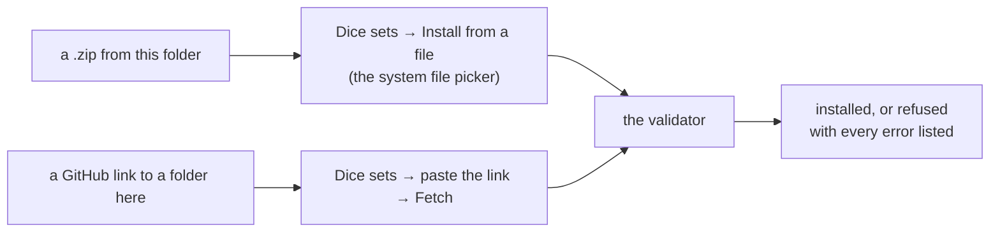

# Sample dice sets

Five finished dice sets, for seeing what the set format's materials do on the
tray and for trying the app's import, from a file and from a link. **The app
comes with all five installed**: it carries these zips and installs them on
its first launch (`docs/dice-sets.md`, "Sets that come installed"). A set
removed in the app stays removed; installing one again from here works as
for any set. Each defines the ten standard dice (`d2` to `d20`, `d10-tens`, `df`), so
plain notation rolls them once they are installed: `marble:d20`,
`steel:3d6`. Halloween has an eleventh, `pumpkin`, which is rolled by name in
braces: `6{halloween:pumpkin}`.

| Set | What it shows | Folder | Archive |
| --- | --- | --- | --- |
| Marble | Artwork on every face — veined stone with the numbers cut into it | [marble/](marble/) | [marble.zip](marble.zip) |
| Steel | A fully metallic body (`metallic = 1`), heavy (`density = 7.8`) | [steel/](steel/) | [steel.zip](steel.zip) |
| Green resin | Somewhat translucent (`translucency = 45`): the felt softly through it | [green-resin/](green-resin/) | [green-resin.zip](green-resin.zip) |
| Red glass | Wholly clear and polished (`translucency = 100`, `roughness = 0.05`) | [red-glass/](red-glass/) | [red-glass.zip](red-glass.zip) |
| Halloween | Glow-in-the-dark frosted resin (`glow = 70`, `glow_color = "#74f0c0"`, `translucency = 30`) with black numbers that do not glow, and `pumpkin`: a cube with a jack-o'-lantern on three faces and the three opposite left blank, worth `[1,0,1,0,1,0]`, so `6{halloween:pumpkin}` counts pumpkins | [halloween/](halloween/) | [halloween.zip](halloween.zip) |

They are not a starting point for a set of your own — that is
[../examples/](../examples/), whose every field is commented. They live apart
from it on purpose: `examples/` is a package you are told to copy and zip, and
a package carrying five more packages inside it would install whichever
`diceset.toml` the app found first.

## Installing one



- **From a file.** Download a zip — on GitHub, open it above and use
  *Download raw file* — and pick it with **Install from a file**. The archive is the folder,
  one level deep, exactly as a downloaded package usually arrives.
- **From a link.** Paste the folder's GitHub address into the link field
  under *Install from a URL or file* and press **Fetch**, for example
  `https://github.com/drehtuer/dInfinityApp/tree/main/sample-sets/marble`.
  The app fetches the repository's archive and installs the one folder the
  link names (`docs/dice-sets.md`, "Installing from a URL or file").

Both go through the same validator a stranger's package does; none of these
five is given any trust the bundled set has.

## How they are made, and how they are checked

| What | Made by | Checked by |
| --- | --- | --- |
| The five `diceset.toml` files | hand | `SampleArchivesTest` (dicesets/install) installs each archive and expects no warnings |
| `marble/textures/*.png` | `MarbleArtwork` (render/filament, test sources) | `MarbleArtworkTest` — the PNGs are what the generator draws, every face is artwork, and the numbers sit where the app would print them |
| `halloween/textures/pumpkin.png` | `HalloweenArtwork` (render/filament, test sources) | `HalloweenArtworkTest` — the PNG is what the generator draws, the three pumpkin faces are drawn and the blank ones left clear, and every pumpkin sits opposite a blank |
| The five `.zip` files | [build-archives.py](build-archives.py) | `SampleArchivesTest` — each holds exactly its folder, byte for byte |

**Why the marble generator is Kotlin and not a script here.** A face with
artwork on it is not printed (`docs/architecture.md`, decision 96), so a
marble die has to carry its numbers in the picture. They are taken from the
app's own printing (`DieNumbers`), so a marble d4's numbers or a d20's
marked `6.` sit exactly where a plain die's would — which only Kotlin in the
app's own build can reach. The pumpkin is drawn the same way so that one
test holds the picture and the set file's values to each other. The archives
need nothing but Python.

**The pumpkin's blank faces are left clear on purpose,** so a blank face is the
die's own pale resin with nothing printed on it — a blank's label is `""`. The
artwork decoder says so when the set is loaded (`AtlasCellsEmpty`,
`docs/dice-sets.md`); the warning is legal and here meant, and installing
reports nothing.

After changing a set, or the printing:

```sh
# the marble pictures (inside the devcontainer)
DINFINITY_WRITE_EXAMPLES=1 ./gradlew :render:filament:testDebugUnitTest \
  --tests '*MarbleArtworkTest*' --rerun

# the pumpkin's picture
DINFINITY_WRITE_EXAMPLES=1 ./gradlew :render:filament:testDebugUnitTest \
  --tests '*HalloweenArtworkTest*' --rerun

# the five archives
python3 sample-sets/build-archives.py
```

Both write the same bytes every time, so a file shows up in `git status` only
when something has actually changed — and a test fails until both have been
run.

## Licence

CC0-1.0, like `examples/`: copy anything here freely.
